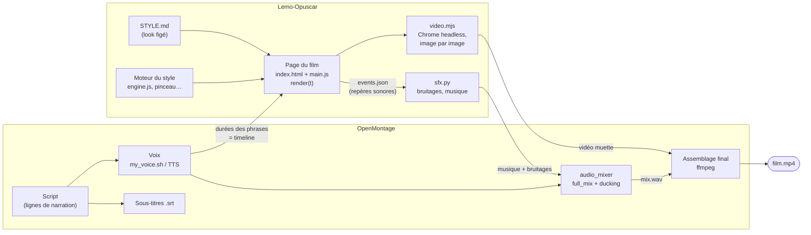
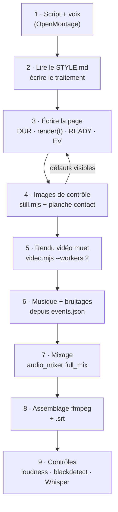
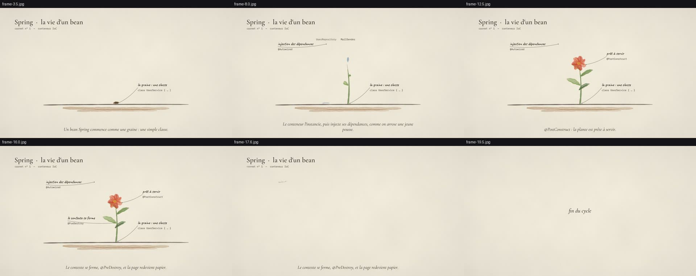
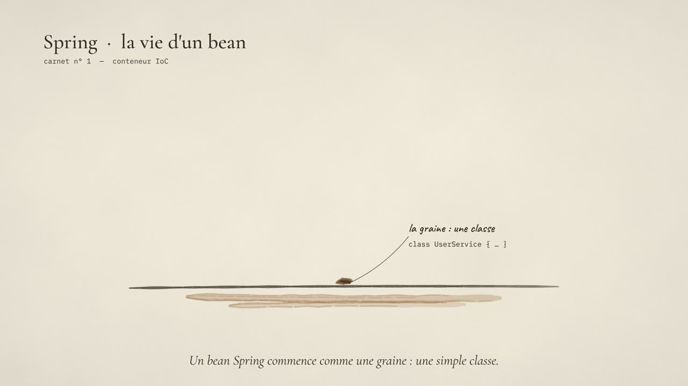
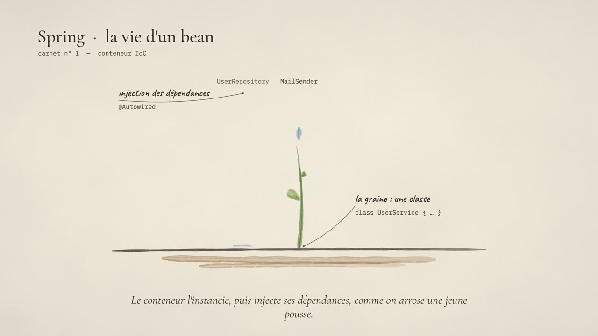
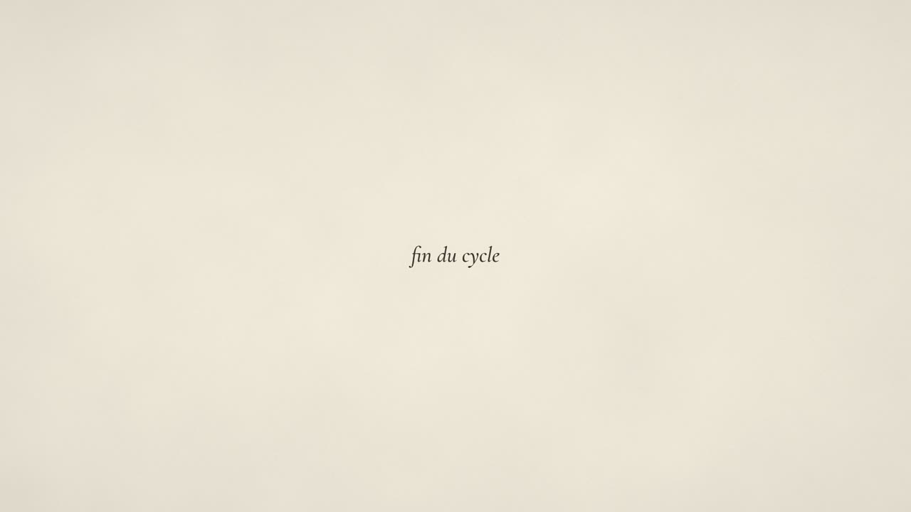
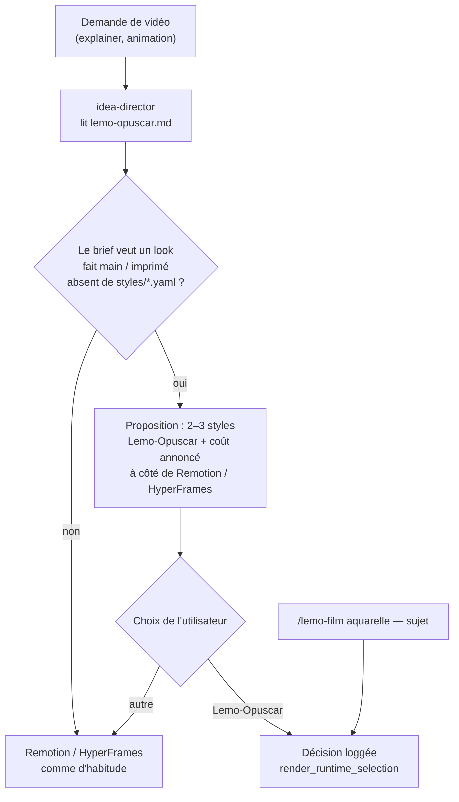
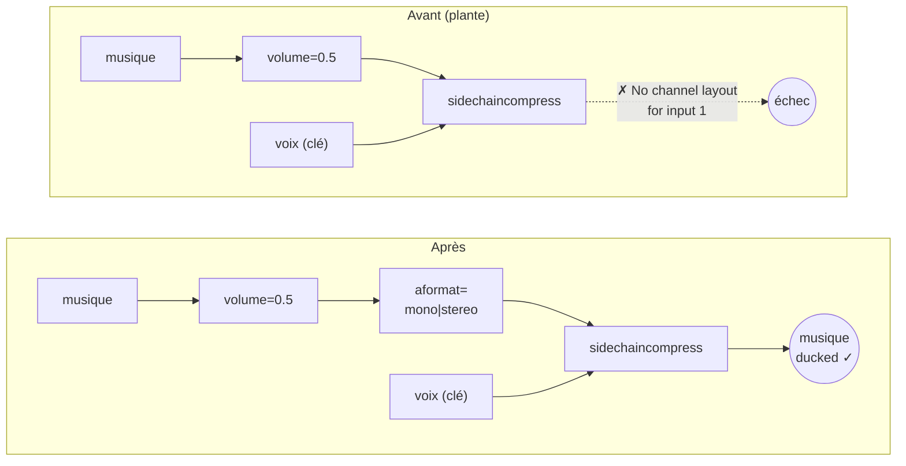
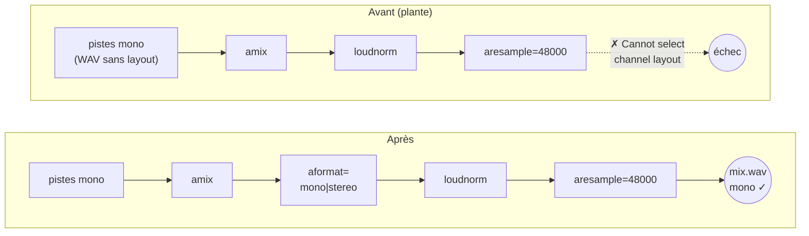
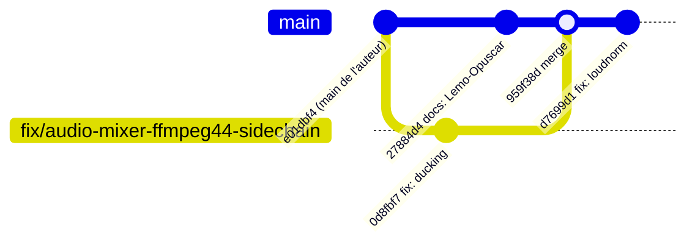

# Intégration Lemo-Opuscar + corrections de l'audio_mixer (octobre 2026)

Ce document décrit les changements faits dans ce fork d'OpenMontage le 25 octobre 2026 :

1. **Lemo-Opuscar** devient une option de rendu visuel : 59 styles de film dessinés entièrement en code (aquarelle, encre, Ukiyo-e, risographie…).
2. **Deux bugs de l'`audio_mixer`** sont corrigés. Avec ffmpeg 4.4, la version installée sur cette machine, ils faisaient planter le mixage.

Les deux parties sont indépendantes : les corrections du mixer profitent à toutes les vidéos, pas seulement à celles faites avec Lemo-Opuscar.

---

## 1. Lemo-Opuscar en bref

[Lemo-Opuscar](https://github.com/lemomo-ai/lemo-opuscar) est une bibliothèque de styles de film pour agents de code. Chaque style fournit :
- un `STYLE.md` qui fixe le look, la palette, la typographie, le mouvement, la grammaire de caméra et l'univers sonore ;
- une démo construite sur un moteur réutilisable (pinceau, rigs, shaders).

**Aucune génération d'image ni de vidéo** : chaque image du film est calculée par une fonction `render(t)` dans une page web, puis capturée image par image par un Chrome sans interface. Galerie des styles : https://lemomo-ai.github.io/lemo-opuscar/

Dans OpenMontage, Lemo-Opuscar est un **moteur d'image + une bibliothèque de styles, pas un pipeline**. Le principe est le même qu'Ink Theater. OpenMontage garde le pipeline, la voix, la musique, le mixage et les sous-titres.

### Qui fait quoi



### Le déroulé d'un film



La **voix vient en premier** parce que la durée de chaque phrase fixe le rythme de l'animation. Les mêmes heures de départ servent dans la page (`VO` dans `main.js`) et dans le mixage (`starts` dans `mix.py`).

---

## 2. Le film de test : « Spring · la vie d'un bean »

Une vidéo de 20 s au style **Watercolor Brush**, narrée avec la voix clonée FR. Le cycle de vie d'un bean Spring y est raconté comme une plante dans un carnet de botaniste.



| Temps | Image | Ce qui se passe | Narration |
|---|---|---|---|
| 1,2 s |  | La graine se peint dans la terre, avec la note `class UserService { … }` | « Un bean Spring commence comme une graine : une simple classe. » |
| 5,2 s |  | La tige pousse ; trois gouttes tombent, une par dépendance injectée (`UserRepository`, `MailSender`, `Clock`) | « Le conteneur l'instancie, puis injecte ses dépendances, comme on arrose une jeune pousse. » |
| 10,6 s |  | La fleur éclot (seule couleur d'accent, vermillon) : `@PostConstruct` | « @PostConstruct : la plante est prête à servir. » |
| 14,0 s |  | Note `@PreDestroy`, puis début de la brume | « Le contexte se ferme, @PreDestroy… » |
| 15,6 s |  | La brume couleur papier efface tout : le papier est redessiné par-dessus | « …et la page redevient papier. » |
| 18,4 s |  | « fin du cycle », une seule note de kalimba | — |

**Chiffres :** 1920×1080, 24 images/s, 480 images rendues en 2 min 13 avec 2 workers, sans GPU. Volume final −15,6 LUFS, aucune image noire.

**Fichiers** (dans `projects/spring-bean-aquarelle/`, qui n'est pas versionné : `projects/` est dans `.gitignore`) :

| Fichier | Rôle |
|---|---|
| `script.json` | Les 4 phrases : texte du sous-titre + version phonétique pour la voix |
| `voice/l1…l4.wav` | Voix clonée FR |
| `page/index.html`, `page/main.js` | L'animation ; `engine.js` est copié du moteur aquarelle de Lemo-Opuscar |
| `score.py` | Musique (kalimba + nappe) et bruitages calés sur `events.json` |
| `mix.py` | Appel à `audio_mixer` `full_mix` (voix + musique + bruitages) |
| `spring-bean-aquarelle.mp4`, `.srt` | Le film et ses sous-titres |

---

## 3. Ce qui a été ajouté dans OpenMontage

| Fichier | Changement |
|---|---|
| [`skills/creative/lemo-opuscar.md`](../skills/creative/lemo-opuscar.md) | **Nouveau.** Le skill : quand proposer l'option, l'installation, le déroulé en 9 étapes, les particularités de cette machine, les licences |
| [`.claude/commands/lemo-film.md`](../.claude/commands/lemo-film.md) | **Nouveau.** Commande `/lemo-film [style] [sujet]` |
| [`AGENT_GUIDE.md`](../AGENT_GUIDE.md) | Section « Film styles drawn in code → Lemo-Opuscar » : l'agent propose l'option à côté de Remotion / HyperFrames, en annonçant le coût |
| `skills/pipelines/explainer/idea-director.md`, `skills/pipelines/animation/idea-director.md` | Une ligne qui pointe vers le skill pendant la phase d'idée |
| `skills/INDEX.md` | Entrée dans l'index des skills |

### Comment l'option est proposée



### Installation (une seule fois)

```sh
git clone --depth 1 https://github.com/lemomo-ai/lemo-opuscar.git ~/Projects277/lemo-opuscar
cd ~/Projects277/lemo-opuscar && sh plugin/skills/lemo-opuscar/scripts/setup.sh deps
```

Cela installe environ 350 Mo : les paquets npm, un Chromium headless et un `.venv` Python. Les niveaux voix et musique de Lemo-Opuscar ne sont pas nécessaires, OpenMontage s'en charge.

### Limites sur cette machine

- **2 cœurs** : `--workers 2`.
- **Pas de GPU** : WebGL passe en rendu logiciel. Les styles 2D sont rapides ; les styles 3D (brick-toy, glass-product, paper-popup…) seront très lents.
- **Ne pas utiliser `core/render/mux.sh` de Lemo-Opuscar.** Avec ffmpeg 4.4, son contrôle de durée sous-estime l'audio d'environ 3 s, à cause du tampon de loudnorm, et refuse un fichier valide. Assembler avec ffmpeg directement.
- **Licences** :
  - le code est sous MIT ;
  - les films de démo sont sous CC BY 4.0, donc il faut créditer LemoLab si on les réutilise ;
  - les films qu'on fabrique soi-même avec la bibliothèque nous appartiennent ;
  - ne jamais réutiliser les voix des démos Game Show Flat, Paper-cut Lightbox et Broadcast News Package.

---

## 4. Corrections de l'`audio_mixer`

Les deux bugs ont la même racine. Avec **ffmpeg 4.4**, certains filtres (`volume`, `loudnorm` + `aresample`) laissent passer un flux audio sans « disposition de canaux » déclarée (mono, stéréo…). Le filtre suivant ne peut alors pas négocier son format, et ffmpeg abandonne. Des versions plus récentes de ffmpeg tolèrent ce cas, ce qui explique que les tests passent ailleurs.

Dans les deux cas, la correction ajoute `aformat=channel_layouts=mono|stereo`. Ce filtre déclare explicitement une disposition **en gardant le nombre de canaux d'origine** : un flux mono reste mono, un flux stéréo reste stéréo. Forcer `stereo` aurait changé le niveau de la voix de 3 dB, ce qu'un test existant détecte.

### Bug 1 : ducking avec une musique dont le volume est réglé

**Symptôme :** `full_mix` avec ducking (la musique baisse quand la voix parle) plantait dès que la piste musique avait un `volume`. C'est le cas de tout mixage voix + musique. ffmpeg affichait « No channel layout for input 1 ».



| | |
|---|---|
| Commit | `0d8fbf7` fix(audio_mixer): pin music layout before sidechaincompress on ffmpeg 4.4 |
| Code | `tools/audio/audio_mixer.py`, construction du graphe de ducking de `full_mix` |
| Test ajouté | `tests/tools/test_audio_mixer_ducking.py::test_full_mix_mono_speech_plus_stereo_music_with_volume` : voix mono + musique stéréo avec volume. Il échoue sans la correction et passe avec |

**Trouver la cause** a demandé de tester le graphe morceau par morceau. `sidechaincompress` seul fonctionnait, de même que `adelay` + `sidechaincompress`. Dès qu'on ajoutait `volume` sur la musique, le graphe échouait. Le coupable était donc `volume`, et non le mélange mono/stéréo qu'on soupçonnait d'abord.

### Bug 2 : normalisation du volume (loudnorm) sur un WAV mono simple

**Symptôme :** `mix` (et `full_mix`) avec normalisation plantait sur des WAV mono sans métadonnées de canaux. ffmpeg affichait « Cannot select channel layout for the link between filters Parsed_aresample and format_out ». Deux tests récents de l'auteur échouaient pour cette raison sur cette machine.



| | |
|---|---|
| Commit | `d7699d1` fix(audio_mixer): pin layout before loudnorm on ffmpeg 4.4 |
| Code | `AudioMixer._loudnorm_filter`, partagé par `mix` et `full_mix` ([audio_mixer.py](../tools/audio/audio_mixer.py)) |
| Tests | Les tests de l'auteur `test_audio_mixer_cache_inputs.py` [normalization] et [loudness] passent désormais. L'assertion de `test_audio_mixer_loudnorm_target.py`, qui vérifie le texte exact du filtre, a été mise à jour |

**Pourquoi avant `loudnorm` et pas après ?** Placé après `aresample`, `aformat` choisit la stéréo et double le canal mono. Placé avant, il fixe la disposition du flux tel qu'il est (mono), et `loudnorm` puis `aresample` la conservent.

### Résultats des tests

| Suite | Résultat |
|---|---|
| Tests du mixer (`tests/tools/test_audio_mixer_*.py`, `tests/qa/test_04_audio_mix.py`, `tests/contracts/test_phase3_contracts.py`) | **133 passent** |
| Suite large (`tests/tools`, `tests/contracts`, `tests/qa`) | 2 067 passent, 2 échecs sans rapport : `test_bmts_lite` et `test_local_video_cache_inputs`. Ils échouent aussi sans ces corrections |
| Mixage réel de `spring-bean-aquarelle` | OK |

---

## 5. Historique git



`d7699d1` a été fait sur la branche `fix/audio-mixer-ffmpeg44-loudnorm`, puis intégré à `main` en avance rapide : il se retrouve donc directement sur la ligne de `main`.

- **Remotes** : `fork` est ce fork (`StioDevolpper/OpenMontage`) ; `origin` est le dépôt de l'auteur (`calesthio/OpenMontage`), sur lequel on ne pousse jamais.
- **Mettre à jour depuis l'auteur** : `git pull origin main`, puis `git push fork main`.
- **Proposer une correction à l'auteur** : pull request depuis `fix/audio-mixer-ffmpeg44-sidechain` ou `fix/audio-mixer-ffmpeg44-loudnorm` vers `calesthio/OpenMontage`. C'est facultatif.
